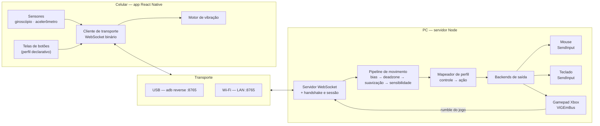

# Arquitetura — Projeto Controle

> Como as peças se encaixam, e o porquê de cada escolha.
> Visão do produto: [VISAO.md](VISAO.md) · Contrato de rede: [PROTOCOLO.md](PROTOCOLO.md)

---

## 1. Visão geral



Regra de ouro: **o celular não decide nada**. Ele mede, mostra e vibra. Toda tradução de
"movimento" para "entrada do sistema" acontece no PC, onde é fácil depurar, medir e mudar.

## 2. Componentes

### 2.1 App (pasta `app/`)

React Native 0.87 *bare* — projeto não gerenciado, porque precisamos de módulos nativos
(sensores, sockets, háptico) e, se a taxa da ponte JS não bastar, de código nativo próprio.

| Camada | Responsabilidade |
|---|---|
| `src/sensores/` | Assinar giroscópio/acelerômetro (ponte tipada para o módulo nativo), carimbar tempo |
| `src/transporte/` | Conectar, reconectar, serializar pacotes binários, heartbeat |
| `src/perfis/` | Carregar o JSON do perfil e renderizar a grade de botões |
| `src/telas/` | Conexão, telemetria, perfil ativo, ajustes |
| `src/haptico/` | Executar comandos de vibração vindos do PC |
| `src/estado/` | Store leve (conexão, perfil ativo, ajustes do usuário) |

**A leitura do giroscópio já é nativa** (ATI-003, ADR-8): um módulo Kotlin próprio
(`GiroscopioModule`) registra o `TYPE_GYROSCOPE` com período em microssegundos e entrega, por
amostra, `gx`/`gy`/`gz` crus, o carimbo monotônico do próprio evento e o `dtMs` medido no nativo.
`src/sensores/giroscopio.ts` é só a ponte tipada: assina, cancela, guarda os assinantes e o estado
da partida — e é por esse estado que a falha chega a todos de uma vez, venha ela da rejeição de
`iniciar()` ou do evento que o nativo emite quando o religar do segundo plano é recusado.

**Ponto de atenção medido na fase 1:** a taxa efetiva que a ponte JS entrega *por cima* dessa
leitura. Se ficar abaixo de ~90 Hz estáveis, o que migra para o nativo é o **envio** — o módulo
empacota e fala direto no socket, e o JS passa a cuidar apenas da interface. A decisão depende do
número que a tela de telemetria produz (ATI-003) e é confirmada com o transporte de pé (ATI-004).

### 2.2 Servidor (pasta `server/`)

Node 22 + TypeScript. Processo único, sem interface gráfica na v1 (CLI com telemetria).

| Módulo | Responsabilidade |
|---|---|
| `transporte/` | Servidor WebSocket, handshake, sessão, heartbeat, descoberta UDP (fase 3) |
| `protocolo/` | Codificação/decodificação dos pacotes; **fonte única** do formato |
| `movimento/` | Calibração de bias, deadzone, suavização, sensibilidade, acumulador de subpixel |
| `perfis/` | Carregar e validar perfis (schema), resolver controle → ação |
| `saida/` | Interface `BackendDeEntrada` + implementações Windows (mouse, teclado, gamepad) |
| `cli/` | Modo telemetria, modo servidor, diagnóstico de latência |
| `montagem.ts` | A **montagem única** do servidor (configuração → backend → pipeline → comandos → ações → fechamento de sessão → transporte), usada por `npm run dev` e `npm run telemetria`. Os dois modos diferem só no que vai para a tela (ATI-027) |

### 2.3 Camada de saída (injeção de entrada)

Interface única, implementações por plataforma (entregue na ATI-007, em `server/src/saida/`):

```ts
interface BackendDeEntrada {
  readonly nome: string;                             // 'windows' | 'dubla'
  readonly contadores: ContadoresDeSaida;            // erro vira número, nunca exceção
  readonly saidaDoMouse?: DescricaoDaSaidaDoMouse;   // ATI-026: saída pedida/efetiva, motivo, aceleração

  moverMouseRelativo(dx: number, dy: number): void;  // ⚠️ caminho quente
  posicionarMouse(x: number, y: number): void;       // usado por "centralizar"
  botaoMouse(botao: 'esquerdo' | 'direito' | 'meio', pressionado: boolean): void;
  scroll(deltaVertical: number, deltaHorizontal: number): void;  // em entalhes (WHEEL_DELTA)
  tecla(scancode: number, pressionada: boolean): void;

  tamanhoDaTela(): TamanhoDaTela | undefined;        // GetSystemMetrics — o centro do "centralizar"
  lerPosicaoDoMouse(): PosicaoDoMouse | undefined;   // GetCursorPos
  pressionados(): number;                            // quanto está preso agora
  soltarTudo(): void;                                // idempotente (CLAUDE.md, regra 5)
  encerrar(): void;                                  // solta tudo e desliga a rede de segurança

  gamepad?: BackendGamepad;                          // opcional, fase 5
}
```

Os cinco primeiros métodos são o esboço original; o resto é o que a regra 5 do CLAUDE.md exige
(`soltarTudo`, `pressionados`) e o que o comando **centralizar** precisa para saber onde é o
centro. Erro de sistema não vira exceção depois que o backend está de pé: `SendInput` devolve
quantos eventos aceitou, e retorno diferente do pedido entra em `contadores.eventosRecusados`
junto com o `GetLastError` — no caminho quente, a 100 Hz, não há quem trate exceção.

Duas implementações: `windows/` (o `SendInput` de verdade) e `dubla.ts`, um backend que só anota
o que foi pedido e mantém um cursor virtual. **Todo teste automático fala com a dubla** — teste
que mexesse no cursor roubaria o mouse de quem está usando a máquina no meio da suíte.

**Windows:** `SendInput` da `user32.dll` chamada por FFI (`koffi`, binário pré-compilado —
sem toolchain de build para o usuário). Motivos da escolha:

- `MOUSEEVENTF_MOVE` entrega movimento **relativo** de verdade, que é o que o gyro aim
  precisa (mover "mais 3 px", não "ir para o pixel 812").
- Teclas por **scancode** (`KEYEVENTF_SCANCODE`), não por virtual-key: jogos que leem
  DirectInput só enxergam scancode.
- Sem dependência nativa compilada (`robotjs` está parado e quebra a cada versão do Node).

**Limitação conhecida e assumida:** `SendInput` marca eventos como injetados. A maioria dos
programas e jogos aceita; alguns títulos com anti-cheat rigoroso ignoram. Para esses, o
caminho é o **gamepad virtual**, que aparece como dispositivo real via driver ViGEmBus.

**A aceleração de ponteiro (medida na ATI-007, resolvida na ATI-026).** O movimento relativo
passa pela *aceleração de ponteiro* do Windows ("Aumentar a precisão do ponteiro"), que não é
linear: 40 eventos de +1 px andam 24 px, um evento de −40 px anda −59 px. Por isso o backend tem
**três saídas** para `moverMouseRelativo`, escolhidas uma vez, na partida (`CONTROLE_SAIDA_MOUSE`).
O que foi escolhido, e por quê, o backend expõe em `saidaDoMouse` (`DescricaoDaSaidaDoMouse`, em
`saida/saida-do-mouse.ts`): é dali que saem a linha do log de partida, o `AVISO` e a linha `ponteiro`
do painel. Só o backend do Windows tem o que dizer; a dubla diz quando o teste pede.

| Saída | Como chega ao Windows | Medido (40 × +1 / 1 × −40) | Para quê |
|---|---|---|---|
| `absoluto` | lê o cursor (`GetCursorPos`), soma o pedido, posiciona com `MOUSEEVENTF_ABSOLUTE \| MOUSEEVENTF_VIRTUALDESK` | **+40 / −40** | área de trabalho: o pixel pedido é o que sai |
| `relativo` | `MOUSEEVENTF_MOVE` cru | +24 / −59 | jogo com *raw input*, que lê antes da curva |
| `auto` (padrão) | `absoluto` se o relativo não sai 1:1 (aceleração ligada ou velocidade ≠ 10), senão `relativo` | — | — |

Decisões que valem registro:

- **Compensar a curva foi medido e descartado como padrão.** O modelo (magnitude `max + min/2`,
  curva do registro, escala de DPI e de velocidade) ajusta o ganho **em regime** com erro de 0,006,
  mas a curva inversa ainda erra a tabela por 1 a 15 px: o ganho de cada evento carrega o
  histórico dos anteriores, e o histórico inclui o mouse físico. Fica só na bancada
  (`ferramentas/provar-aceleracao.mjs`).
- **A régua do absoluto é a área de trabalho virtual** (todos os monitores, origem que pode ser
  negativa), lida a cada evento — monitor entra e sai com o servidor de pé. O destino é limitado
  só ao retângulo virtual; ponto fora de qualquer monitor o Windows encosta no mais próximo, e o
  próximo evento parte de onde o cursor ficou: nada "gruda" na borda.
- **Na saída absoluta a thread fica em `PER_MONITOR_AWARE_V2`**, para `GetCursorPos` e a área
  virtual responderem em pixel físico — a régua da coordenada normalizada — também em monitor com
  escala diferente da do primário.
- **A configuração de ponteiro é só lida, nunca escrita.** O servidor avisa (log de partida e
  painel) e escolhe a saída; quem desliga a aceleração é a pessoa.

### 2.4 Vibração (ciclo completo)

```
jogo → gamepad virtual (ViGEm) → callback de rumble no servidor
     → pacote RUMBLE → app → Vibration / Core Haptics
```

Fora de jogo, o servidor também dispara vibração curta como retorno de clique e como aviso
de conexão/desconexão. Padrões hápticos são nomeados (`click`, `tick`, `erro`, `sucesso`),
não durações cruas — assim iOS e Android podem usar o motor de cada plataforma do jeito certo.

## 3. Pipeline de movimento (o coração)

Executado no servidor, uma vez por pacote de sensor:

```
gx,gy,gz (rad/s, cru)
  → 1. desconta bias        (calibração: média com o aparelho parado)
  → 2. escolhe eixos        (mapeamento local ou de mundo, conforme orientação do perfil)
  → 3. aplica zona morta    (|ω| < deadzone → 0, com transição suave)
  → 4. suaviza              (filtro adaptativo 1€ — padrão desde a ATI-033 — ou EMA de coeficiente fixo)
  → 5. aplica sensibilidade (px por grau, separado em X e Y, com inversão opcional)
  → 6. integra pelo dt real (dx = ω · dt, usando o dt medido no aparelho)
  → 7. acumula subpixel     (guarda a fração; sem isso, movimento lento vira zero)
  → dx, dy inteiros → moverMouseRelativo()
```

Detalhes que decidem se fica bom ou ruim:

- **`dt` vem do aparelho, não do PC.** O carimbo de tempo do celular mede o intervalo real
  entre amostras. Usar a hora de chegada no PC embute o jitter da rede no movimento.
- **Bias é obrigatório.** Um giroscópio parado costuma acusar 0,002–0,02 rad/s. Sem
  descontar, o cursor caminha sozinho — é a causa nº 1 de "esse app é ruim".
- **Zona morta com transição suave**, não corte seco: corte seco cria um degrau perceptível
  quando a mão treme perto do limiar.
- **Tremor se separa por frequência, não por amplitude** (ATI-033). Tremor de mão e mira fina são
  os dois movimento lento; o que os distingue é que o tremor oscila de 5 a 12 Hz em torno de um
  ponto. Por isso a zona morta ficou só com o ruído do sensor (0,15 °/s) e quem tira o tremor é o
  filtro da etapa 4.
- **Acumulador de subpixel**: `SendInput` só aceita inteiros. Movimento lento gera 0,4 px
  por amostra; sem acumular a fração, o cursor simplesmente não anda.
- **Pacote atrasado é descartado**, nunca reproduzido em lote. Reproduzir gera um salto.

Entregue na **ATI-008**, em `server/src/movimento/` (ver o README do módulo). Duas decisões da
implementação que valem registro aqui:

- **A unidade exposta é pixel por grau**; a conversão para pixel por radiano acontece uma vez, na
  resolução do ajuste, e nunca por amostra.
- **O atraso é medido contra o caminho mais rápido já visto na sessão**, e não com relógio de
  parede: o carimbo do aparelho e o do PC contam de origens diferentes, então o que dá para saber
  é a *variação* do atraso. O relógio do PC decide descarte e **nunca** deslocamento.
- **O destino padrão não é o cursor.** A configuração `movimento` vale `desligado`, `ensaio`
  (padrão — mede e não move nada) ou `sistema`. Ligar o `SendInput` de verdade é pedido explícito
  de quem está na máquina.
- **Estado guardado tem dono declarado** (rodada 2 da ATI-008). Trocar orientação ou inverter um
  eixo zera a média exponencial (e, desde a ATI-033, o pendente do filtro adaptativo) — ela foi
  medida no referencial antigo e sairia para o lado
  contrário; religar o giro esquece tudo, como uma retomada; mexer em sensibilidade, zona morta ou
  suavização **não** esquece nada, senão o cursor engasgaria a cada passo do controle deslizante.
- **Só sessão que completou o handshake solta estado.** A limpeza da memória do pipeline (e a
  soltura de botão da ATI-007) acontece no fim da sessão **adotada**; conexão que abre e cai sem
  `hello` não é sessão de ninguém e não pode apagar o estado de quem está com o celular na mão.
- **Sensibilidade também se pede em graus de tela cheia** (ATI-032): "quantos graus atravessam a
  tela". O servidor divide a resolução (`GetSystemMetrics`) pelos graus, **cada eixo pelo seu
  lado** — 45° numa tela 1920×1080 dão 42,67 px/grau na horizontal e 24 na vertical — e o vertical
  aceita número próprio, porque o pulso inclina bem menos do que gira. O resultado continua sendo
  `sensX`/`sensY` em px/grau; os graus são só outra porta de entrada para os mesmos dois números.
  Ajuste pedido que não pode ser atendido (graus sem tamanho de tela, conta fora da faixa) vira
  aviso na partida, nunca troca calada pelo padrão de fábrica.
- **A etapa 4 é o filtro adaptativo 1€** (ATI-033, `server/src/movimento/filtro-adaptativo.ts`):
  `corte = corteMinimo + beta · rapidez`, com a rapidez medida pelo próprio giroscópio. Parado ou
  tremendo, o corte fica em 1,5 Hz e o tremor sintético de 8–12 Hz cai 99 %; atravessando a tela, o
  corte sobe e o atraso acrescentado fica abaixo de 10 ms (meta: 15). Ele filtra a **posição** —
  guardando só o pendente — porque filtrar a velocidade com corte variável não conserva o
  deslocamento, e usa **um corte para os dois eixos**, senão a diagonal entorta. A média exponencial
  continua disponível (`CONTROLE_FILTRO=exponencial`). Os padrões saíram de medição
  (`server/ferramentas/medir-filtro.mjs`); a calibragem contra tremor de mão real ainda depende de
  uma captura com a pessoa segurando o aparelho parado de propósito.

### 3.1 Mapeamento de eixos: espaço local × espaço de mundo

O sistema de coordenadas do giroscópio é preso ao aparelho, não à tela.

- **Espaço local (v1):** o perfil declara a pegada — `retrato`, `paisagem`, `apontador` ou
  `apontador-torcao` — e o servidor escolhe quais eixos viram horizontal e vertical. Simples e
  determinístico. Enquanto o perfil (ATI-016) não existe, a pegada vem da configuração
  (`CONTROLE_ORIENTACAO`, ATI-032).
- **Espaço de mundo (v2):** usa o vetor gravidade do acelerômetro para projetar a
  velocidade angular no referencial do mundo — a rotação em torno do eixo da gravidade vira
  movimento horizontal, independentemente de como a pessoa está segurando o aparelho. É o
  que dá a sensação natural (é o que o Steam Input chama de *world space*).

Os sinais de cada eixo (o que é "para a direita") ficam configuráveis por perfil (`inverterX`,
`inverterY`). As duas primeiras pegadas são da ATI-008, as duas deitadas da ATI-032:

| Orientação | Como se segura | Horizontal (→ direita) | Vertical (→ baixo, como no Windows) | Ignorado |
|---|---|---|---|---|
| `retrato` | de pé, tela para a pessoa | `−gy` | `−gx` | `gz` (*roll*) |
| `paisagem` | de lado, tela para a pessoa | `−gx` | `+gy` | `gz` (*roll*) |
| `apontador` | deitado, tela para cima, topo apontando para o PC | `−gz` (apontar) | `−gx` (inclinar o nariz) | `gy` (*roll*) |
| `apontador-torcao` | a mesma pegada deitada | `−gz` (apontar) | `+gy` (torcer o antebraço) | `gx` (inclinar) |

**O eixo ignorado depende da pegada.** Nas três primeiras é o *roll* — o giro em torno do eixo que
aponta, que não muda a mira: com a tela virada para a pessoa quem aponta é `−z` e o roll é `gz`;
deitado, quem aponta é `+y` e o roll passa a ser `gy`. Na `apontador-torcao` o roll vira o vertical
de propósito (o antebraço torce perto de 180° sem esforço, o pulso inclina 25–30° antes de doer), e
quem sai de cena é a inclinação. O preço é que torcer não muda para onde o aparelho aponta: na
vertical, a metáfora deixa de ser "mirar" e vira manete.

Escolher a pegada errada não dá erro nenhum: o cursor responde ao gesto errado e parece
impreciso. Foi o primeiro defeito sentido com o cursor de verdade (ATI-032) — o aparelho deitado
com a orientação em `retrato` descarta o `gz` de quem aponta e move o cursor com a torção do pulso.
O conserto definitivo é o espaço de mundo (v2), em que a pegada deixa de ser declarada e vira medida.

⚠️ **Essa tabela é derivação em papel** — sistema de coordenadas do Android mais regra da mão
direita —, **não medição com aparelho na mão**: nenhum build Android roda nesta máquina (ATI-024).
A confirmação de bancada continua pendente, e é por isso que os dois campos de inversão existem.

### 3.2 De onde vem o bias da etapa 1 (ATI-009)

A etapa 1 desconta um número que alguém precisa medir. Quem mede é o comando **sincronizar**
(`calibrar-inicio`/`calibrar-fim` do PROTOCOLO.md, seção 3.5), entregue em
`server/src/movimento/calibracao.ts`:

- **Média com descarte dos extremos.** As amostras de cada eixo são ordenadas e 10 % de cada
  ponta saem da conta — uma batida na mesa ou o toque do dedo que soltou o botão produzem um
  punhado de amostras muito fora do resto, e a média simples as carrega para dentro do bias.
- **Duas recusas, não uma.** A **dispersão** (desvio padrão da série inteira, antes da aparagem)
  pega o aparelho que balançou; o **módulo da média** pega a calibração feita durante uma
  rotação, que tem dispersão zero porque todas as amostras são iguais. Sem as duas, um dos dois
  casos passaria — e calibração ruim é pior que nenhuma: ela vira movimento constante do cursor,
  sem pista de onde veio.
- **Mínimo de 60 amostras** (0,6 s a 100 Hz), alvo de 120. Menos que isso é média de ruído.

O bias é guardado **por aparelho** (`aparelho.id` do `hello`) em `server/dados-locais/bias.json`,
fora do repositório: recalibrar a cada cabo plugado transformaria o passo mais chato do produto em
rotina. Arquivo corrompido não derruba o servidor — vira contador e aviso, e a sessão segue com
bias zero.

**Recalibração automática** (`recalibracao.ts`): com o aparelho parado por mais de 3 s, o bias
passa a seguir a leitura por média exponencial lenta (constante de tempo de 20 s), aplicada no
pipeline a cada 500 ms. É o que faz a diferença entre um controle bom no primeiro minuto e um
controle bom depois de uma hora — o bias de um giroscópio MEMS anda com a temperatura do aparelho.
Qualquer amostra fora do limiar de "parado" zera a contagem: enquanto a pessoa está mirando,
ninguém mexe no bias. A chave `recalibracao` da configuração desliga o mecanismo.

⚠️ **O impasse da estimativa, e como ele se resolve** (conserto da rodada 2 da ATI-009). "Parado" é
medido pela distância entre a leitura e a estimativa atual, e a estimativa só anda **dentro** da
janela que só abre depois de 3 s de "parado". Uma estimativa plantada longe da leitura de verdade
fecha o laço: toda amostra interrompe, a janela nunca abre, e o mecanismo morre calado — justamente
no caso que ele existe para resolver (aparelho que esquentou **entre** sessões e voltou com o bias
guardado defasado) e no caso da primeira conexão sem bias guardado, em que a leitura inicial pode
trazer o toque do dedo. A saída é não deixar a estimativa ser a única testemunha: quando a leitura
está longe dela, as amostras passam a ser comparadas **umas com as outras**, e uma leitura que se
sustenta coerente consigo mesma replanta a estimativa.

Esse replantio é a porta por onde gesto poderia virar bias, e por isso ela tem **três portões**
(rodada 3 da ATI-009 — na rodada 2 eram dois, e um gesto lento e constante passava pelos dois):

| Portão | O que ele pergunta | Número |
|---|---|---|
| coerência | esta série é ruído em torno de um patamar? | desvio da média da sequência ≤ **0,4 °/s** — a ordem do ruído do sensor, e não do gesto |
| módulo | uma leitura deste tamanho pode ser bias? | ≤ **5 °/s**, teto próprio do caminho automático |
| ângulo | a rotação equivalente já seria absurda? | acima de 1,5 °/s, exige `módulo × tempo` > **60°** (20 s a 3 °/s, 12 s a 5 °/s) |

Os números são mais duros que os do `calibrar-fim` de propósito: lá **uma pessoa afirma** que o
aparelho está parado (ela apoiou e mandou calibrar), aqui não existe afirmação nenhuma. Quem tem
sensor pior que o teto automático continua podendo calibrar na mão.

O replantio **não** mexe no bias: ele só recoloca a estimativa perto da realidade, e daí até a
primeira aplicação ainda são 3 s de leitura dentro do limiar da estimativa recém-plantada — o que é
**continuidade da mesma leitura**, e não uma segunda prova de aparelho parado. Quem separa bias de
gesto são os três portões; os 3 s existem para nenhuma correção chegar ao cursor de supetão.

**Centralizar** (ADR-7) leva o cursor ao centro e **zera o estado guardado do pipeline** — média
exponencial e fração de subpixel. Sem isso o resíduo do gesto anterior sai depois do salto e o
cursor escorrega ao recomeçar. Com `movimento` em `ensaio` (o padrão), o comando calcula o centro,
zera o pipeline e responde — sem encostar no cursor de quem está usando a máquina.

## 4. Perfis de controle

Um perfil é um JSON validado por schema, guardado em `server/perfis/` e enviado ao app no
handshake. Esboço da v1:

```jsonc
{
  "id": "mouse-basico",
  "nome": "Mouse básico",
  "versao": 1,
  "saida": "mouse",              // mouse | teclado | gamepad | hibrido
  "orientacao": "retrato",       // retrato | paisagem | apontador | apontador-torcao (seção 3.1)
  "gyro": {
    "ativo": true,
    "alvo": "cursor",            // cursor | stick-direito
    "espaco": "local",           // local | mundo
    "sensX": 35, "sensY": 35,    // pixels por grau de rotação
    "deadzone": 0.15,            // graus por segundo (0,35 até a ATI-033: hoje só o ruído do sensor)
    "filtro": "euro",            // euro (adaptativo, ATI-033) | exponencial (usa a suavizacao)
    "suavizacao": 0.15,          // 0 = sem suavização, 1 = travado — só com filtro exponencial
    "inverterX": false, "inverterY": false,
    "gatilho": "sempre"          // sempre | segurando  (botão de "ativar giro")
  },
  "layout": { "colunas": 4, "linhas": 6 },
  "controles": [
    { "id": 1, "tipo": "botao", "rotulo": "Esquerdo", "x": 0, "y": 5, "w": 2, "h": 1,
      "acao": { "tipo": "mouse", "botao": "esquerdo" }, "haptico": "click" },
    { "id": 2, "tipo": "botao", "rotulo": "Direito", "x": 2, "y": 5, "w": 2, "h": 1,
      "acao": { "tipo": "mouse", "botao": "direito" }, "haptico": "click" },
    { "id": 3, "tipo": "botao", "rotulo": "Meio", "x": 1, "y": 4, "w": 2, "h": 1,
      "acao": { "tipo": "mouse", "botao": "meio" }, "haptico": "tick" },
    { "id": 4, "tipo": "faixa-scroll", "rotulo": "Scroll", "x": 3, "y": 0, "w": 1, "h": 4,
      "acao": { "tipo": "scroll", "eixo": "vertical" } },
    { "id": 5, "tipo": "botao", "rotulo": "Centralizar", "x": 0, "y": 0, "w": 1, "h": 1,
      "acao": { "tipo": "interno", "comando": "centralizar" } },
    { "id": 6, "tipo": "botao", "rotulo": "Sincronizar", "x": 1, "y": 0, "w": 1, "h": 1,
      "acao": { "tipo": "interno", "comando": "calibrar" } }
  ]
}
```

Tipos de controle previstos: `botao`, `botao-manter`, `alternar`, `stick`, `gatilho`,
`faixa-scroll`, `dpad`, `slider`.
Tipos de ação: `mouse`, `tecla`, `scroll`, `gamepad-botao`, `gamepad-eixo`, `interno`, `macro`.

**Consequência arquitetural:** adicionar um controle novo é adicionar um caso no mapeador do
servidor e um renderizador no app — nunca uma tela nova escrita à mão.

**Estado da implementação (ATI-010).** O perfil ainda não é arquivo: o schema validado é a
ATI-016 e o mapeador declarativo genérico é a ATI-018. O que existe hoje é a mesma informação
declarada em código, em `server/src/acoes/mouse-basico.ts` — `idControle → ação` para os três
botões do mouse (ids 1, 2 e 3, como no esboço acima) e para dois botões de passo de scroll
(ids 7 e 8, que o esboço não tem). Os ids 4, 5 e 6 continuam reservados ao que o esboço declarou:
a faixa-scroll — que viaja como pacote SCROLL e por isso **não tem `idControle`**
(PROTOCOLO.md, seção 4.4) — e os dois comandos internos, que viajam como quadro de texto `cmd`
(ATI-009). Quando o schema entrar, essa tabela vira o caso de teste do carregador.

## 5. Transporte

| Aspecto | Decisão |
|---|---|
| Canal | WebSocket sobre TCP, porta **8765** |
| Cabo | `adb reverse tcp:8765 tcp:8765` — o app fala com `127.0.0.1:8765` e o tráfego sai pelo USB |
| Wi-Fi | Mesmo servidor, IP do PC na LAN; descoberta por broadcast UDP na porta **8766** |
| Formato | Binário para tudo que é entrada (alta frequência); JSON só no controle de sessão |
| Ajustes de TCP | `setNoDelay(true)` obrigatório dos dois lados — sem isso o Nagle agrupa pacotes e cria atraso |
| Sessão | Um aparelho por vez na v1; conexão nova derruba a anterior |

**Por que não UDP, já que é o transporte natural para sensor?** Porque `adb reverse` só faz
TCP, e o cabo é o modo principal. Um caminho só, testado o tempo todo, vale mais do que dois
caminhos com comportamentos diferentes. UDP fica como otimização opcional do modo Wi-Fi, se a
medição mostrar necessidade.

## 6. Segurança

- Servidor escuta em `127.0.0.1` no modo cabo; no modo Wi-Fi, só na interface da LAN.
- **Pareamento por token**: na primeira conexão o PC mostra um código de 6 dígitos; o app
  envia no handshake e recebe um token persistente. Sem token válido, a conexão cai.
- Nada de segredo em arquivo versionado. Token do aparelho fica no `AppData` do usuário.
- Sem nuvem, sem conta, sem telemetria — o tráfego não sai da casa.

## 7. Decisões registradas (ADR resumido)

| # | Decisão | Consequência |
|---|---|---|
| ADR-1 | Emular mouse/gamepad em vez de integrar por jogo | Compatibilidade universal; dependemos das limitações de anti-cheat |
| ADR-2 | React Native bare | Um app para as duas plataformas; assume-se manutenção de código nativo quando necessário |
| ADR-3 | WebSocket binário sobre TCP | Um caminho só para cabo e Wi-Fi; abrimos mão do ganho marginal do UDP |
| ADR-4 | Regra no servidor, sensor cru no fio | Ajuste e depuração num lugar só; o app fica burro de propósito |
| ADR-5 | `koffi` + `SendInput` em vez de `robotjs`/`nut.js` | Sem toolchain de compilação para o usuário; escrevemos as structs à mão |
| ADR-6 | Perfis declarativos em JSON | Controle novo sem release; exige schema e validação desde cedo |
| ADR-7 | Giroscópio relativo (não orientação absoluta) | Sem drift acumulado nem interferência magnética; exige o comando "centralizar" |
| ADR-8 | Leitura do giroscópio por módulo nativo próprio (Kotlin), não por `react-native-sensors` | Carimbo monotônico por evento, `dtMs` medido no nativo e período em µs — sem isso a própria medição da ATI-003 mediria o filtro da biblioteca; em troca, o Kotlin do app vira item de manutenção |

## 8. O que ainda não está decidido

- ~~Biblioteca de sensores no app (`react-native-sensors` × módulo nativo próprio)~~ — **resolvido
  pela ATI-003**: módulo nativo próprio (ADR-8).
- Onde mora o **envio** da amostra (JS × módulo nativo falando direto no socket) — decide a taxa
  medida na ATI-003, confirmada com o transporte de pé na ATI-004.
- Formato de armazenamento dos perfis no celular (arquivo × AsyncStorage) — fase 4.
- Se o servidor terá interface gráfica (Electron/Tauri) ou continuará CLI + bandeja — fase 7.
